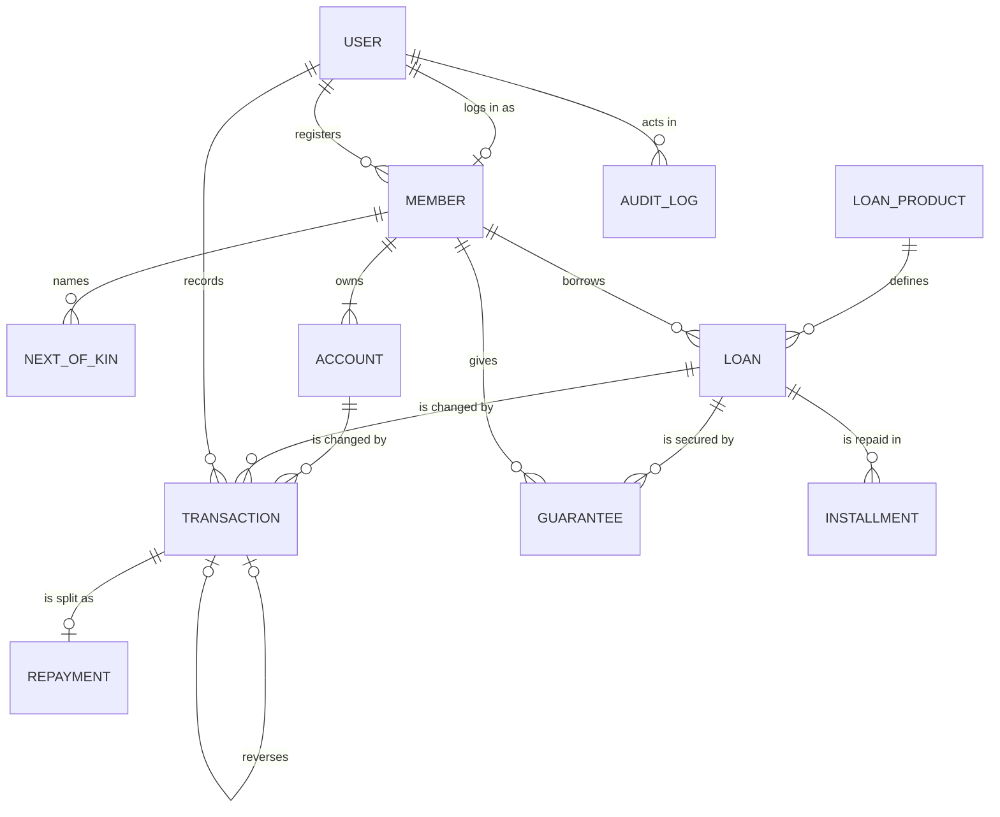

# Data Model

## 1. Entity Relationship Diagram

## 2. Tables

Conventions
- Every table has `id` (PK) and `created_at`. Times are stored in UTC and shown in EAT.
- Money: Decimal, 14 digits, 2 decimal places, KES. Never float.
- Financial foreign keys use PROTECT: a member, account or loan with
  transactions can never be deleted.

### MEMBER
| Field | Type | Rules |
|---|---|---|
| user_id | FK → USER | nullable, unique (1:1) |
| membership_number | text | unique, generated, e.g. M-000123 |
| full_name | text | required |
| national_id | text | unique, 7–8 digits |
| date_of_birth | date | required; age ≥ 18 at registration |
| phone_number | text | required; 07/01 + 8 digits |
| email | text | optional |
| agreed_monthly_contribution | money | > 0 |
| status | choice | pending, active, rejected, suspended, exited |
| registered_by | FK → USER | required |
| approved_by | FK → USER | nullable; must differ from registered_by |
| approved_at | datetime | nullable |
| status_reason | text | required when rejected or suspended |

### NEXT_OF_KIN
| Field | Type | Rules |
|---|---|---|
| member_id | FK → MEMBER | required |
| full_name | text | required |
| relationship | text | e.g. spouse, parent |
| phone_number | text | required |

### ACCOUNT
| Field | Type | Rules |
|---|---|---|
| member_id | FK → MEMBER | required |
| account_type | choice | savings, shares |
| account_number | text | unique |
| (member_id, account_type) | | unique together: one of each type per member |

### TRANSACTION (the ledger, insert-only)
| Field | Type | Rules |
|---|---|---|
| reference | text | unique (e.g. M-Pesa code); prevents double counting |
| transaction_type | choice | contribution, share_purchase, disbursement, repayment, reversal |
| direction | choice | credit (money in), debit (money out) |
| amount | money | > 0 (direction carries the sign) |
| account_id | FK → ACCOUNT | nullable |
| loan_id | FK → LOAN | nullable |
| reverses_id | FK → TRANSACTION | nullable, unique |
| narration | text | required for reversals |
| recorded_by | FK → USER | required |
| posted_at | datetime | required |
| Rule | | exactly one of account_id / loan_id is set |
| Rule | | rows are never updated or deleted |

### LOAN_PRODUCT
| Field | Type | Rules |
|---|---|---|
| name | text | unique |
| interest_method | choice | flat, reducing_balance [confirm Q5] |
| annual_interest_rate | decimal | > 0 [confirm Q5] |
| max_term_months | integer | > 0 |
| savings_multiplier | decimal | e.g. 3.00 [confirm Q4] |
| min_membership_months | integer | e.g. 6 [confirm Q4] |
| required_guarantee_pct | decimal | e.g. 100 [confirm Q6] |
| is_active | boolean | |

### LOAN
| Field | Type | Rules |
|---|---|---|
| loan_number | text | unique |
| member_id | FK → MEMBER | required |
| product_id | FK → LOAN_PRODUCT | required |
| principal | money | > 0; ≤ savings × multiplier |
| term_months | integer | ≤ product max |
| interest_rate | decimal | copied from product when applying |
| status | choice | submitted, awaiting_guarantors, under_review, approved, rejected, cancelled, active, in_arrears, closed |
| decided_by | FK → USER | nullable; not the applicant or a guarantor |
| decided_at | datetime | nullable |
| decision_reason | text | required when rejected |
| disbursed_by | FK → USER | nullable; must differ from decided_by |
| disbursed_at | datetime | nullable |

### GUARANTEE (junction table: MEMBER ↔ LOAN)
| Field | Type | Rules |
|---|---|---|
| loan_id | FK → LOAN | required |
| guarantor_id | FK → MEMBER | required; not the borrower |
| amount | money | > 0; ≤ guarantor's free capacity |
| status | choice | requested, accepted, declined, released |
| responded_at | datetime | nullable |
| (loan_id, guarantor_id) | | unique together |

### INSTALLMENT
| Field | Type | Rules |
|---|---|---|
| loan_id | FK → LOAN | required |
| number | integer | 1, 2, 3 … |
| due_date | date | required |
| principal_due | money | ≥ 0 |
| interest_due | money | ≥ 0 |
| status | choice | due, partly_paid, paid, overdue |
| (loan_id, number) | | unique together |

### REPAYMENT
| Field | Type | Rules |
|---|---|---|
| transaction_id | FK → TRANSACTION | unique (1:1) |
| principal_paid, interest_paid, fees_paid, penalty_paid | money | ≥ 0; must add up to the transaction amount |

### AUDIT_LOG
| Field | Type | Rules |
|---|---|---|
| actor_id | FK → USER | required |
| action | text | e.g. member.approved |
| object_type, object_id | text, integer | what was changed |
| before, after | JSON | values before and after |
| ip_address | text | optional |
| Rule | | insert-only, never edited |

## 3. Balances are calculated, never edited

Account balance
    Balance = sum(credit amounts) − sum(debit amounts)
            for all TRANSACTION rows on that account

Loan outstanding
    Outstanding = disbursed principal + interest charged + fees + penalties
                − sum(repayments)

Free guarantee capacity of a member
    Free_capacity = savings balance
                  − sum(GUARANTEE.amount where status = accepted
                        and the loan is still active)

Rules
- A balance is never typed in or edited by a person.
- If a cached balance is added later for speed, a reconciliation test must
  prove it equals the ledger total (roadmap Dec 4).
- Every money operation runs inside a database transaction: either every
  row is saved or none is (roadmap Nov 30).

## 4. Story coverage

| Story | Tables used | Covered? |
|---|---|---|
| S-1 Register member | USER, MEMBER, NEXT_OF_KIN | ✅ |
| S-2 Approve member | MEMBER (approved_by ≠ registered_by), ACCOUNT, AUDIT_LOG | ✅ |
| S-3 Record contribution | TRANSACTION (unique reference), ACCOUNT | ✅ |
| S-4 View balance and statement | ACCOUNT, TRANSACTION | ✅ |
| S-5 Apply for loan | LOAN, LOAN_PRODUCT, ACCOUNT (savings balance) | ✅ |
| S-6 Respond to guarantee | GUARANTEE, ACCOUNT (free capacity) | ✅ |
| S-7 Decide loan | LOAN (decided_by), GUARANTEE | ✅ |
| S-8 Disburse loan | LOAN (disbursed_by), TRANSACTION, INSTALLMENT | ✅ |